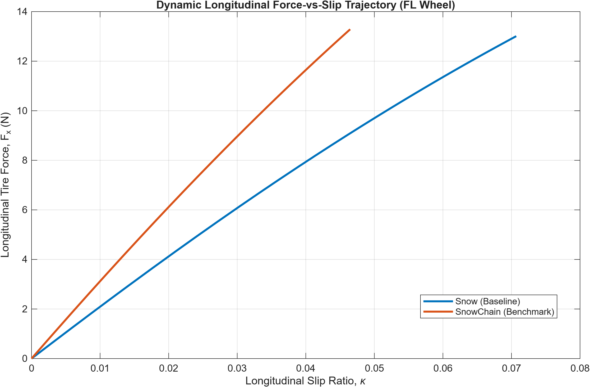
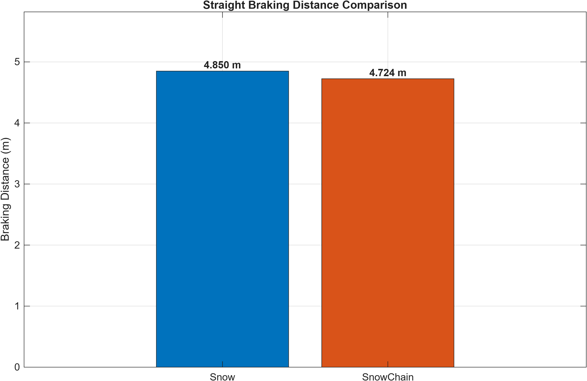
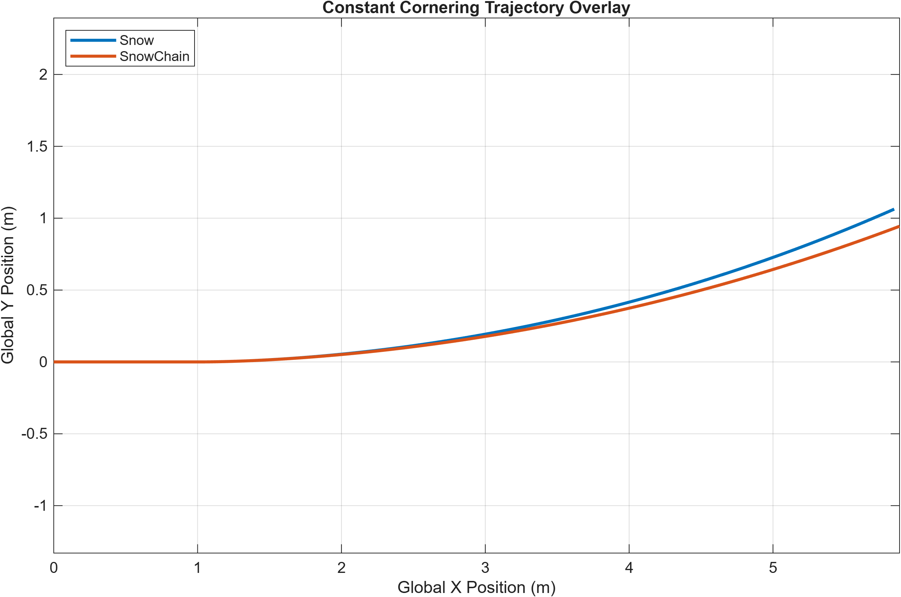
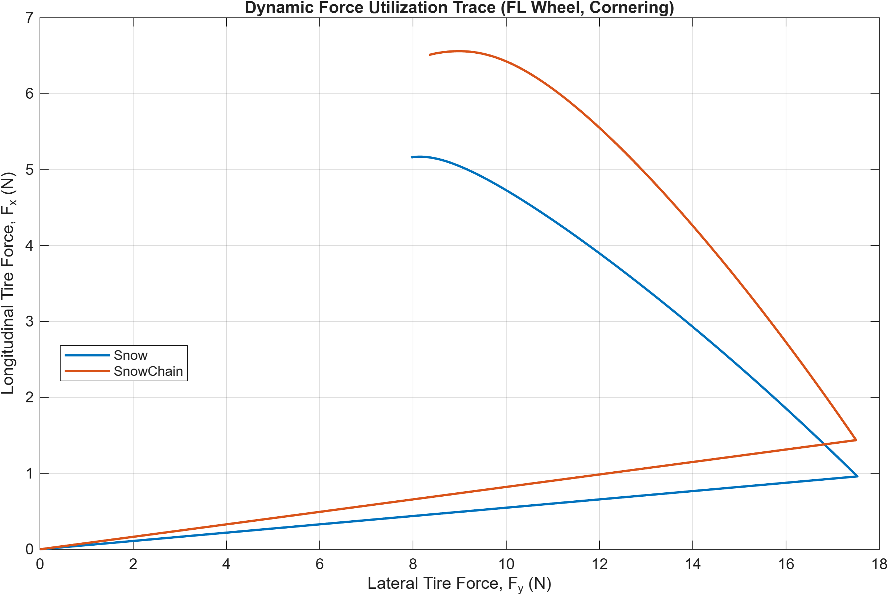

# Second Sensitivity Scenario: Original Illustrative Snow Parameters

This document preserves the earlier illustrative Phase 3K run for comparison with the current reference-coefficient benchmark in the [main project README](../README.md).

This is a historical sensitivity scenario, not a separate experiment, a validated snow-chain model, or a direct prediction of real-world performance. The current reference-coefficient benchmark is the primary result presented in the main README.

## Earlier parameterisation

The original illustrative snow baseline used the following pure-slip Magic Formula values:

| Parameter | Longitudinal | Lateral |
|---|---:|---:|
| B | 4.0 | 4.0 |
| C | 1.2 | 1.2 |
| D | 0.30 | 0.30 |
| E | 0.97 | 0.97 |

The earlier SnowChain sensitivity case applied the same illustrative 1.5× multiplier to the longitudinal peak factor, changing `Dx` from 0.30 to 0.45. Lateral and combined-slip parameters were retained. These original values were illustrative assumptions and were not calibrated from tire-on-snow measurements.

## Earlier simulated results

| Maneuver | Snow | Simplified SnowChain | Difference |
|---|---:|---:|---:|
| Straight acceleration — final speed | 3.736 m/s | 3.822 m/s | +0.086 m/s (+2.3%) |
| Straight acceleration — peak Fx | 56.038 N | 57.335 N | +1.297 N (+2.3%) |
| Straight braking — braking distance | 4.850 m | 4.724 m | −0.126 m (−2.6%) |
| Constant cornering — peak Fy | 37.455 N | 37.508 N | +0.053 N (about +0.1%) |
| Constant cornering — peak yaw rate | 0.159 rad/s | 0.135 rad/s | −0.024 rad/s |
| Constant cornering — final lateral deviation | 1.063 m | 0.944 m | −0.119 m |

These numbers are outputs from the earlier simplified simulation and apply only to that parameterisation, the specified maneuvers, and the numerical setup used at the time. They should not be combined with the current reference-coefficient results.

## Archived figures

### Dynamic longitudinal force versus slip

### Straight braking distance

### Constant-cornering trajectory

### Dynamic force trace

## Interpretation and limitations

The earlier run showed the expected direction of change under its assumed longitudinal-force scaling: slightly higher simulated acceleration speed and peak longitudinal force, and a shorter simulated braking distance. Its cornering outputs showed differences in lateral force, yaw response, and lateral trajectory.

These are model outputs, not measured effects of real snow chains. In particular, the trajectory and yaw-rate differences should be described as altered simulated vehicle response, not proof of improved stability. The model did not explicitly simulate chain-link contact, snow compaction, digging, tread interaction, or environmental snow properties.

For the current reference-coefficient benchmark and its updated figures, use the [main project README](../README.md).
